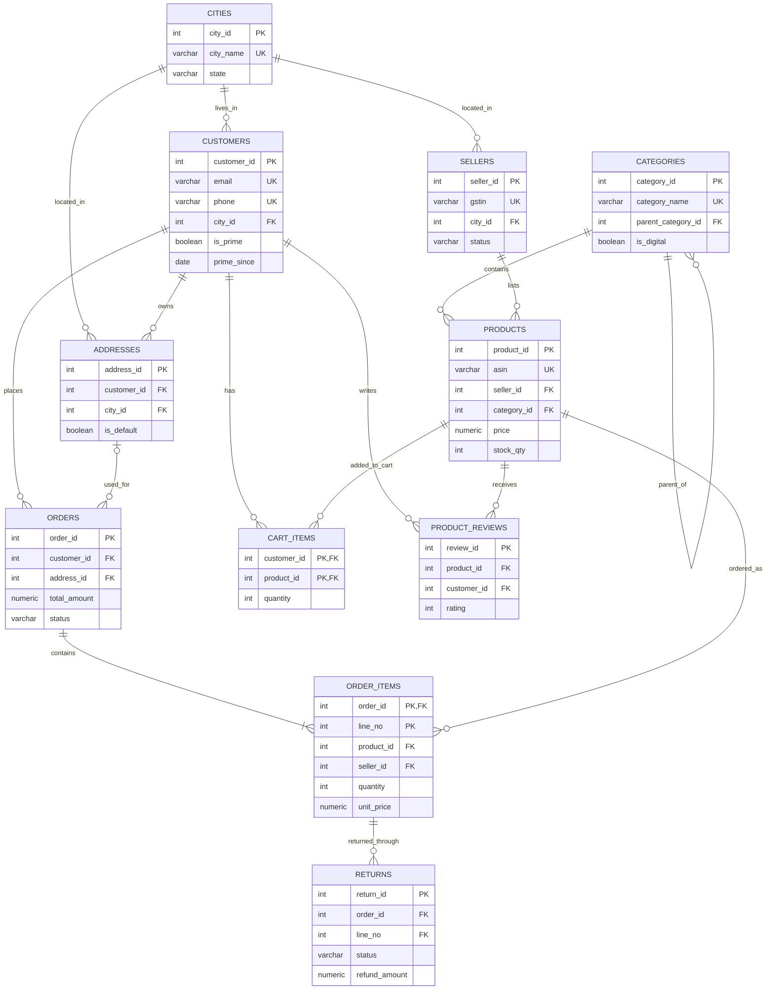

# Schema Design – Amazon Online Shopping Database

## 1. Overview

The database is designed to support an Amazon-like online shopping platform. It stores information about customers, sellers, products, categories, addresses, orders, shopping carts, reviews, and returns.

The database uses a relational model and is implemented in PostgreSQL under the `amazon` schema.

**Total tables:** 11  
**Total records loaded:** 565,614

The schema uses primary keys, foreign keys, unique constraints, NOT NULL constraints, and CHECK constraints to maintain data integrity.

---

## 2. Table Design and Data Dictionary

### 2.1 cities

Stores city and state information used by customers, sellers, and addresses.

| Column | Data Type | Constraints | Description |
|---|---|---|---|
| city_id | INTEGER | PK, NOT NULL | Unique city identifier |
| city_name | VARCHAR(100) | UNIQUE, NOT NULL | Name of the city |
| state | VARCHAR(100) | NOT NULL | State containing the city |

### 2.2 categories

Stores product categories and their hierarchical relationships.

| Column | Data Type | Constraints | Description |
|---|---|---|---|
| category_id | INTEGER | PK, NOT NULL | Unique category identifier |
| category_name | VARCHAR(100) | UNIQUE, NOT NULL | Category name |
| parent_category_id | INTEGER | FK, NULL allowed | Parent category |
| is_digital | BOOLEAN | NOT NULL | Indicates whether the category contains digital products |

A category can have a parent category, allowing hierarchical category organization. A category cannot be its own parent.

### 2.3 customers

Stores customer account and membership information.

| Column | Data Type | Constraints | Description |
|---|---|---|---|
| customer_id | INTEGER | PK, NOT NULL | Unique customer identifier |
| full_name | VARCHAR(150) | NOT NULL | Customer's full name |
| email | VARCHAR(255) | UNIQUE, NOT NULL | Customer email |
| phone | VARCHAR(20) | UNIQUE, NOT NULL | Customer phone number |
| city_id | INTEGER | FK, NOT NULL | Customer's city |
| signup_date | DATE | NOT NULL | Account registration date |
| is_prime | BOOLEAN | NOT NULL | Prime membership status |
| prime_since | DATE | NULL allowed | Date Prime membership started |

Prime membership rules:
- A Prime customer must have a `prime_since` date.
- A non-Prime customer must have `prime_since` as NULL.
- The Prime membership date cannot be earlier than the signup date.

### 2.4 sellers

Stores marketplace seller information.

| Column | Data Type | Constraints | Description |
|---|---|---|---|
| seller_id | INTEGER | PK, NOT NULL | Unique seller identifier |
| business_name | VARCHAR(200) | NOT NULL | Seller business name |
| gstin | VARCHAR(15) | UNIQUE, NOT NULL | Seller GST identification number |
| city_id | INTEGER | FK, NOT NULL | Seller's city |
| joined_on | DATE | NOT NULL | Date seller joined |
| seller_rating | NUMERIC(2,1) | NOT NULL | Seller rating |
| status | VARCHAR(20) | NOT NULL | Seller account status |

Allowed seller statuses: `ACTIVE`, `SUSPENDED`, `CLOSED`.

The GSTIN must contain exactly 15 characters, and seller ratings must be between 0 and 5.

### 2.5 addresses

Stores customer delivery addresses.

| Column | Data Type | Constraints | Description |
|---|---|---|---|
| address_id | INTEGER | PK, NOT NULL | Unique address identifier |
| customer_id | INTEGER | FK, NOT NULL | Customer who owns the address |
| label | VARCHAR(20) | NOT NULL | Address type |
| line1 | VARCHAR(255) | NOT NULL | Address details |
| city_id | INTEGER | FK, NOT NULL | Address city |
| pincode | VARCHAR(10) | NOT NULL | Postal code |
| is_default | BOOLEAN | NOT NULL | Whether this is the customer's default address |

Allowed address labels: `HOME`, `WORK`.

The combination `(address_id, customer_id)` is also declared UNIQUE so that an order can reference an address belonging to the same customer.

### 2.6 products

Stores product catalogue and inventory information.

| Column | Data Type | Constraints | Description |
|---|---|---|---|
| product_id | INTEGER | PK, NOT NULL | Unique product identifier |
| asin | VARCHAR(20) | UNIQUE, NOT NULL | Amazon Standard Identification Number |
| seller_id | INTEGER | FK, NOT NULL | Seller offering the product |
| category_id | INTEGER | FK, NOT NULL | Product category |
| title | VARCHAR(255) | NOT NULL | Product title |
| brand | VARCHAR(100) | NOT NULL | Product brand |
| mrp | NUMERIC(12,2) | NOT NULL | Maximum retail price |
| price | NUMERIC(12,2) | NOT NULL | Selling price |
| stock_qty | INTEGER | NOT NULL | Available stock |
| is_prime_eligible | BOOLEAN | NOT NULL | Prime eligibility |
| avg_rating | NUMERIC(2,1) | NULL allowed | Average product rating |
| review_count | INTEGER | NOT NULL | Number of reviews |
| listed_on | DATE | NOT NULL | Product listing date |
| status | VARCHAR(20) | NOT NULL | Product status |

Business rules:
- Selling price must be greater than zero.
- MRP must be greater than or equal to selling price.
- Stock quantity cannot be negative.
- Average rating must be between 1 and 5 when present.
- Review count cannot be negative.
- A product with zero reviews must have a NULL average rating.
- Allowed product statuses: `ACTIVE`, `INACTIVE`, `OUT_OF_STOCK`.

The pair `(product_id, seller_id)` is declared UNIQUE to support the composite foreign key from `order_items`.

### 2.7 orders

Stores customer order and payment information.

| Column | Data Type | Constraints | Description |
|---|---|---|---|
| order_id | INTEGER | PK, NOT NULL | Unique order identifier |
| customer_id | INTEGER | FK, NOT NULL | Customer who placed the order |
| address_id | INTEGER | Composite FK, NULL allowed | Delivery address |
| ordered_at | TIMESTAMPTZ | NOT NULL | Order placement timestamp |
| payment_method | VARCHAR(30) | NOT NULL | Payment method |
| total_amount | NUMERIC(12,2) | NOT NULL | Order total |
| status | VARCHAR(30) | NOT NULL | Current order status |
| shipped_at | TIMESTAMPTZ | NULL allowed | Shipping timestamp |
| delivered_at | TIMESTAMPTZ | NULL allowed | Delivery timestamp |

Allowed payment methods: `CARD`, `COD`, `EMI`, `GIFT_CARD`, `NETBANKING`, `UPI`.

Allowed order statuses: `PLACED`, `PACKED`, `SHIPPED`, `OUT_FOR_DELIVERY`, `DELIVERED`, `CANCELLED`, `RETURNED`.

The composite foreign key `(address_id, customer_id)` ensures that a non-NULL delivery address belongs to the customer placing the order.

An address may be NULL for orders containing digital products.

Shipping and delivery timestamps cannot be earlier than the order placement timestamp.

### 2.8 order_items

Stores individual product lines within customer orders.

| Column | Data Type | Constraints | Description |
|---|---|---|---|
| order_id | INTEGER | Composite PK, FK, NOT NULL | Associated order |
| line_no | SMALLINT | Composite PK, NOT NULL | Line number within the order |
| product_id | INTEGER | FK, NOT NULL | Ordered product |
| seller_id | INTEGER | Composite FK, NOT NULL | Seller of the product |
| quantity | SMALLINT | NOT NULL | Ordered quantity |
| unit_price | NUMERIC(12,2) | NOT NULL | Price per unit at purchase time |

The composite primary key `(order_id, line_no)` uniquely identifies each order line.

The composite foreign key `(product_id, seller_id)` ensures that the seller recorded on the order line matches the seller associated with the product.

Quantity, line number, and unit price must be positive.

### 2.9 cart_items

Stores products currently present in customer shopping carts.

| Column | Data Type | Constraints | Description |
|---|---|---|---|
| customer_id | INTEGER | Composite PK, FK, NOT NULL | Customer owning the cart item |
| product_id | INTEGER | Composite PK, FK, NOT NULL | Product added to cart |
| quantity | SMALLINT | NOT NULL | Quantity selected |
| added_at | TIMESTAMPTZ | NOT NULL | Time item was added |

The composite primary key `(customer_id, product_id)` prevents the same product from appearing as multiple separate entries for the same customer.

Quantity must be greater than zero.

### 2.10 product_reviews

Stores customer reviews and ratings for products.

| Column | Data Type | Constraints | Description |
|---|---|---|---|
| review_id | INTEGER | PK, NOT NULL | Unique review identifier |
| product_id | INTEGER | FK, NOT NULL | Reviewed product |
| customer_id | INTEGER | FK, NOT NULL | Customer who submitted review |
| rating | SMALLINT | NOT NULL | Rating from 1 to 5 |
| title | VARCHAR(255) | NOT NULL | Review title |
| body | TEXT | NULL allowed | Review description |
| verified_purchase | BOOLEAN | NOT NULL | Whether purchase was verified |
| helpful_votes | INTEGER | NOT NULL | Number of helpful votes |
| created_at | TIMESTAMPTZ | NOT NULL | Review creation timestamp |

Rating must be between 1 and 5. Helpful votes cannot be negative.

### 2.11 returns

Stores product return requests associated with order lines.

| Column | Data Type | Constraints | Description |
|---|---|---|---|
| return_id | INTEGER | PK, NOT NULL | Unique return identifier |
| order_id | INTEGER | Composite FK, NOT NULL | Original order |
| line_no | SMALLINT | Composite FK, NOT NULL | Returned order line |
| reason | VARCHAR(40) | NOT NULL | Reason for return |
| requested_at | TIMESTAMPTZ | NOT NULL | Return request timestamp |
| status | VARCHAR(20) | NOT NULL | Return status |
| refund_amount | NUMERIC(12,2) | NULL allowed | Refund amount |

Allowed return reasons: `QUALITY_ISSUE`, `WRONG_ITEM`, `DAMAGED`, `SIZE_ISSUE`, `NOT_AS_DESCRIBED`, `NO_LONGER_NEEDED`.

Allowed return statuses: `REQUESTED`, `PICKED_UP`, `REFUNDED`, `REJECTED`.

A refunded return must have a positive refund amount. Other return statuses must have a NULL refund amount.

---

## 3. Primary Keys and Foreign Keys

### Primary Keys

| Table | Primary Key |
|---|---|
| cities | city_id |
| categories | category_id |
| customers | customer_id |
| sellers | seller_id |
| addresses | address_id |
| products | product_id |
| orders | order_id |
| order_items | (order_id, line_no) |
| cart_items | (customer_id, product_id) |
| product_reviews | review_id |
| returns | return_id |

### Foreign Key Relationships

| Child Table | Foreign Key | Referenced Table |
|---|---|---|
| categories | parent_category_id | categories(category_id) |
| customers | city_id | cities(city_id) |
| sellers | city_id | cities(city_id) |
| addresses | customer_id | customers(customer_id) |
| addresses | city_id | cities(city_id) |
| products | seller_id | sellers(seller_id) |
| products | category_id | categories(category_id) |
| orders | customer_id | customers(customer_id) |
| orders | (address_id, customer_id) | addresses(address_id, customer_id) |
| order_items | order_id | orders(order_id) |
| order_items | (product_id, seller_id) | products(product_id, seller_id) |
| cart_items | customer_id | customers(customer_id) |
| cart_items | product_id | products(product_id) |
| product_reviews | product_id | products(product_id) |
| product_reviews | customer_id | customers(customer_id) |
| returns | (order_id, line_no) | order_items(order_id, line_no) |

Foreign keys use `ON DELETE RESTRICT` to prevent deletion of parent records that are referenced by dependent records.

---

## 4. Entity Relationship Diagram

The main relationships are:

- One city can be associated with many customers, sellers, and addresses.
- One category can contain many products.
- A category can have a parent category.
- One customer can have multiple addresses, orders, cart items, and reviews.
- One seller can list multiple products.
- One product can appear in multiple order items, cart items, and reviews.
- One order can contain multiple order items.
- One order item can be associated with return records.
- Each order belongs to one customer.
- Each non-NULL order address must belong to the same customer as the order.

### Mermaid ER Diagram Source

---

## 5. Functional Dependencies

A functional dependency (FD) describes how one attribute or set of attributes determines another attribute or set of attributes.

The main functional dependencies in this database are:

| Table | Functional Dependency |
|---|---|
| cities | city_id → city_name, state |
| categories | category_id → category_name, parent_category_id, is_digital |
| customers | customer_id → full_name, email, phone, city_id, signup_date, is_prime, prime_since |
| sellers | seller_id → business_name, gstin, city_id, joined_on, seller_rating, status |
| addresses | address_id → customer_id, label, line1, city_id, pincode, is_default |
| products | product_id → asin, seller_id, category_id, title, brand, mrp, price, stock_qty, is_prime_eligible, avg_rating, review_count, listed_on, status |
| orders | order_id → customer_id, address_id, ordered_at, payment_method, total_amount, status, shipped_at, delivered_at |
| order_items | (order_id, line_no) → product_id, seller_id, quantity, unit_price |
| cart_items | (customer_id, product_id) → quantity, added_at |
| product_reviews | review_id → product_id, customer_id, rating, title, body, verified_purchase, helpful_votes, created_at |
| returns | return_id → order_id, line_no, reason, requested_at, status, refund_amount |

Additional candidate-key dependencies:

- email → customer_id and the other customer attributes, because email is UNIQUE.
- phone → customer_id and the other customer attributes, because phone is UNIQUE.
- gstin → seller_id and the other seller attributes, because GSTIN is UNIQUE.
- asin → product_id and the other product attributes, because ASIN is UNIQUE.
- city_name → city_id and state, because city_name is UNIQUE.
- category_name → category_id, parent_category_id, and is_digital, because category_name is UNIQUE.

### Important Dependency in order_items

Each product is associated with one seller in